


**Karyerlardan qazib olinadigan qurilish materiallari nazorati tizimi:** ANPR kamera har bir mashinani darvozada qayd etadi, tarozi yukni tortadi, tizim esa darvoza → tarozi → yuk xati → elektron TTN zanjirini solishtirib, hujjatsiz chiqqan reysni o'zi topadi.

---

## Hodisalar — jonli xarita

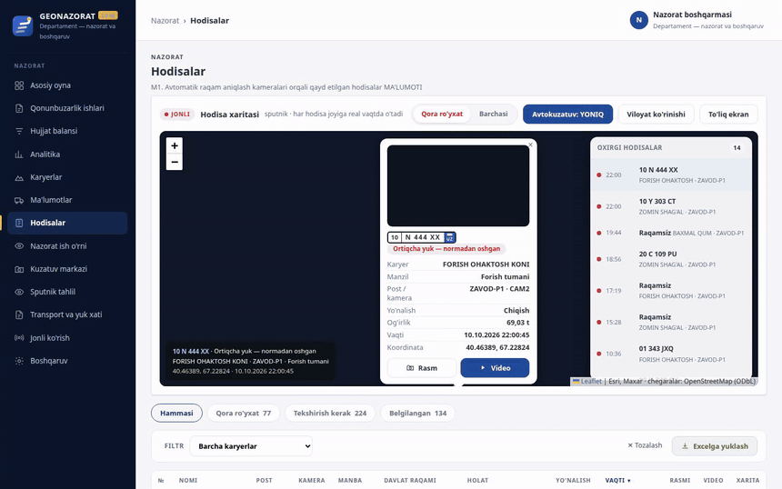

Har yangi ANPR o'tishida xarita o'sha nazorat nuqtasiga uchib boradi. Belgini bosganda davlat raqami, kon, post va kamera, yo'nalish, og'irlik, koordinata hamda kadr va video chiqadi. «Qora ro'yxat» rejimida faqat qoidabuzarliklar ko'rinadi:

- davlat raqami aniqlanmagan;
- qora ro'yxatdagi transport;
- ortiqcha yuk;
- ruxsat etilmagan vaqtda chiqish (tunda);
- yuk xati yo'q.

## Asosiy imkoniyatlar

| | |
|---|---|
| 📷 **ANPR qabul** | Kamera hodisani ISAPI push yoki FTP orqali yuboradi. FTP faqat kon ichidagi LAN'da, kon agentida ochiladi: agent faylni disk navbatiga yozadi va serverga HTTPS orqali uzatadi |
| ⚖️ **Tarozi agenti** | Kirish va chiqish tortuvlari (tara/brutto) avtomatik yoziladi. Hajm tarozidan kelmaydi: tonna ÷ material zichligi, ekranda esa «hisoblangan hajm» deb ko'rsatiladi |
| 🧾 **Hujjat balansi** | Har reys to'rtta iz qoldiradi: darvozadan chiqish, tortuv, yuk xati, elektron TTN. Izlar soni teng bo'lmasa, zanjir qaysi bo'g'inda uzilgani kon kesimida ko'rinadi |
| 🚛 **Transport va yuk xati** | Mashinalar bazasi (firma, kon, tara va ko'tarish), yuk xati berish va izli bekor qilish, qora ro'yxat |
| 🚨 **Nazoratchi ish o'rni** | Qoidabuzarliklar og'irligi va ko'rib chiqish muddati bo'yicha saralanadi. Har qatorda dalil, transport va yuk xati. Xulosa izohi majburiy, kerak bo'lsa patrulga yuboriladi |
| ⚖️ **Qonunbuzarlik ishlari** | Tasdiqlangan qoidabuzarlikdan ish ochiladi, muddat sanaladi. Qarorni faqat boshqarma chiqaradi (jarima yoki qo'shimcha tekshiruv) |
| 💰 **Soliq solishtiruvi** | Choraklik: tizim hisobi va kon egasi deklaratsiyasi. Farq kichik bo'lsa «mos», sezilarli kam ko'rsatilsa — ish ochish asosi |
| 🛰️ **Sputnik nazorati** | Alohida analitik ish o'rni (navbat, kadr, mozaika, qiyos, dalil): kon chegarasidan chiqib qazish sun'iy yo'ldosh tasvirida tekshiriladi |
| 🛠️ **Texnik markaz** | Har kon uchun pasport va texnik kamchiliklar ro'yxati: nazorat nuqtasi belgilanmagan, kamera ulanmagan, tarozi kaliti berilmagan va hokazo |
| 👥 **11 rol** | Boshqarma, administrator, kon egasi, nazoratchi, soliq, patrul, sputnik analitigi, texnik va kon ish joylari (tarozi, post, ombor). Har rol faqat o'z bo'limlarini ko'radi |
| 🔐 **Xavfsizlik** | Parollar PBKDF2 bilan saqlanadi, xato urinishlar cheklanadi. Kamera parollari bazada shifrlangan. Media cookie orqali beriladi, havolada token yo'q |

## Ekranlar

<table>
<tr>
<td width="50%"> <b>Asosiy oyna</b> — kon xulosasi va viloyat sputnik xaritasi</td>
<td width="50%">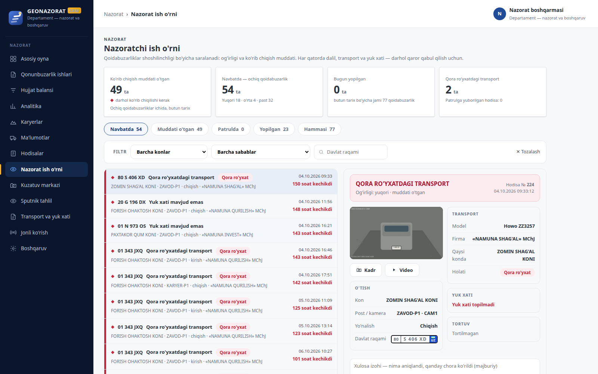 <b>Nazoratchi ish o'rni</b> — navbat, muddat, dalil va transport kartasi</td>
</tr>
<tr>
<td>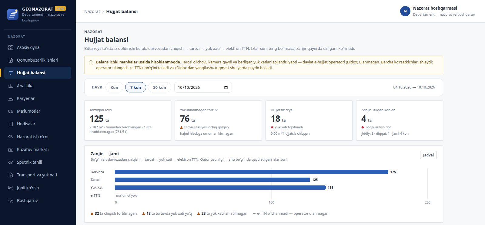 <b>Hujjat balansi</b> — darvoza → tarozi → yuk xati → e-TTN zanjiri</td>
<td>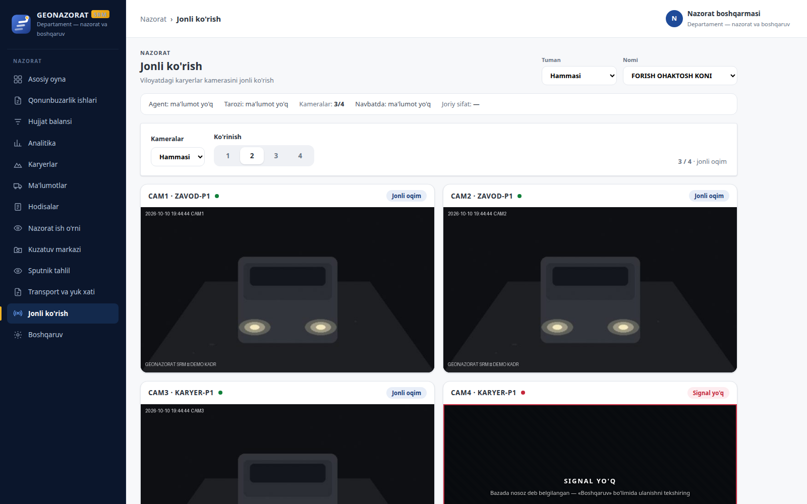 <b>Jonli ko'rish</b> — kon kameralari (namuna kadr generatori)</td>
</tr>
<tr>
<td>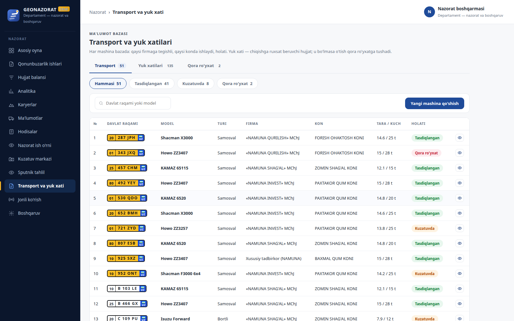 <b>Transport va yuk xati</b> — mashinalar bazasi va holati</td>
<td>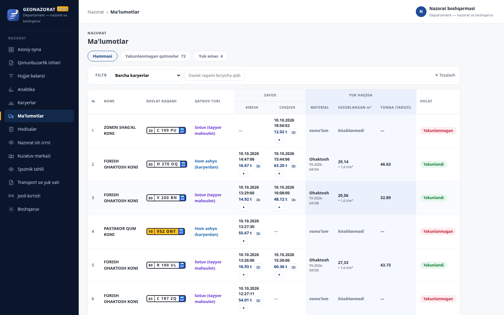 <b>Ma'lumotlar</b> — har qatnovning kirish/chiqish tortuvi va hisoblangan hajmi</td>
</tr>
<tr>
<td>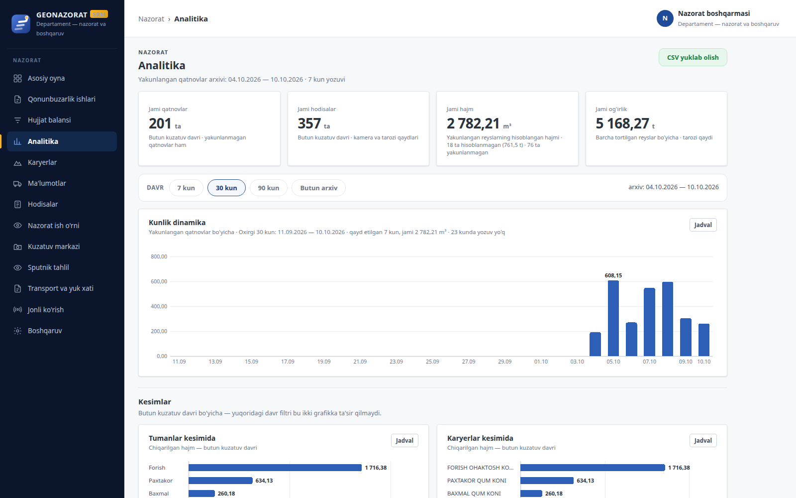 <b>Analitika</b> — kunlik dinamika, tuman va kon kesimlari</td>
<td>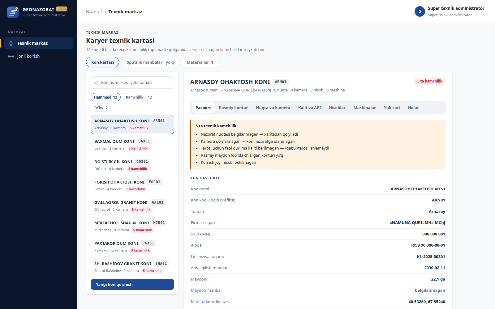 <b>Texnik markaz</b> — kon pasporti va texnik kamchiliklar</td>
</tr>
<tr>
<td colspan="2">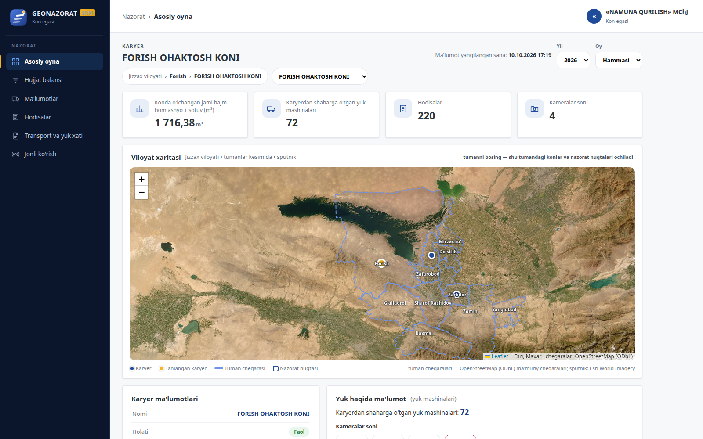 <b>Kon egasi kabineti</b> — faqat o'z koni, qisqa menyu</td>
</tr>
</table>

> Suratlardagi firmalar, mashinalar, davlat raqamlari, tortuvlar va kamera kadrlari **namuna ma'lumot** (demo rejimi). Kon nomlari tuman nomidan yasalgan shartli nomlar.

## Arxitektura

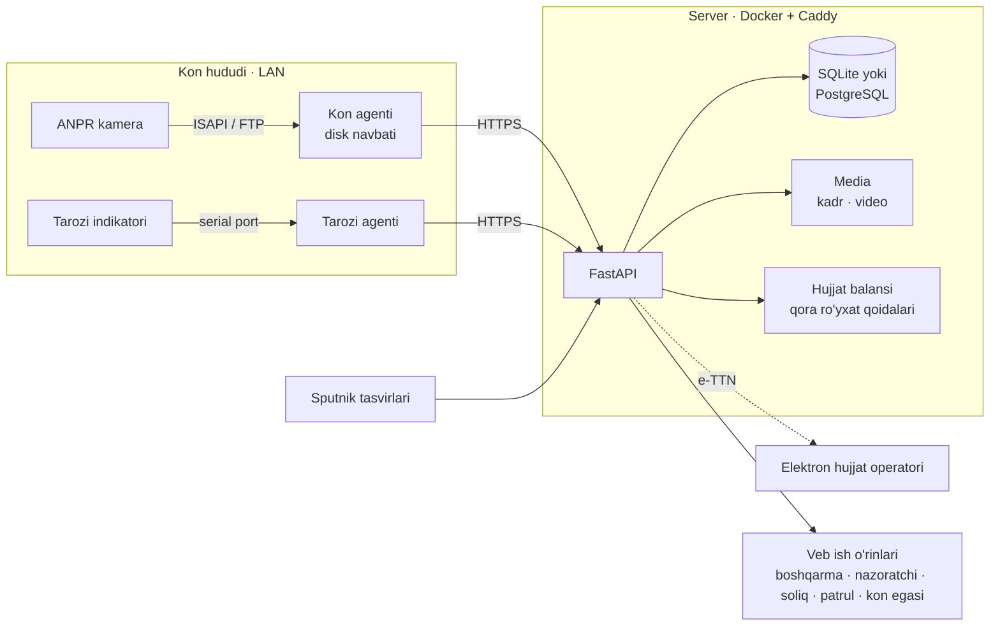

- **Halollik qoidasi:** o'lchanmagan qiymat 0 emas, «—» bo'lib chiqadi. Hisoblangan son «o'lchangan» deb atalmaydi.
- **Demo va prod rejimi:** demo ma'lumot faqat demo rejimida ekiladi. Prod bazasiga uydirma kon va «qoidabuzarlik» tushmaydi.
- **Elektron TTN:** operator ulanmaguncha zanjirning bu bo'g'ini «ma'lumot yo'q» deb ko'rsatiladi, qolgan ko'rsatkichlar ishlayveradi.

## Sifat

`pytest` — **178 ta sinov**: API, ruxsat matritsasi, hujjat balansi, yuk xati, qaror chiqarish, vaqt zonasi va boshqalar. Ishga tushirilgan sanada 177 tasi o'tdi. Bittasi (soliq solishtiruvi) testda 3-chorak qattiq yozilgani uchun 4-chorakda yiqiladi: namuna ma'lumot joriy sanaga yasaladi.

## Texnologiyalar

Python 3 · FastAPI · SQLAlchemy 2 · SQLite / PostgreSQL · Pydantic · Pillow · cryptography (Fernet) · vanilla JavaScript · Leaflet + Esri World Imagery · OpenStreetMap chegaralari · Docker + Caddy

## Jonli

🌐 [geonazorat.uz](https://geonazorat.uz) — xizmat kirishi (login talab qilinadi)

---

**Manba kodi yopiq.** Namoyish yoki hamkorlik bo'yicha: Telegram [@Humoyun_Davronov](https://t.me/Humoyun_Davronov)

Muallif — Humoyun Davronov

